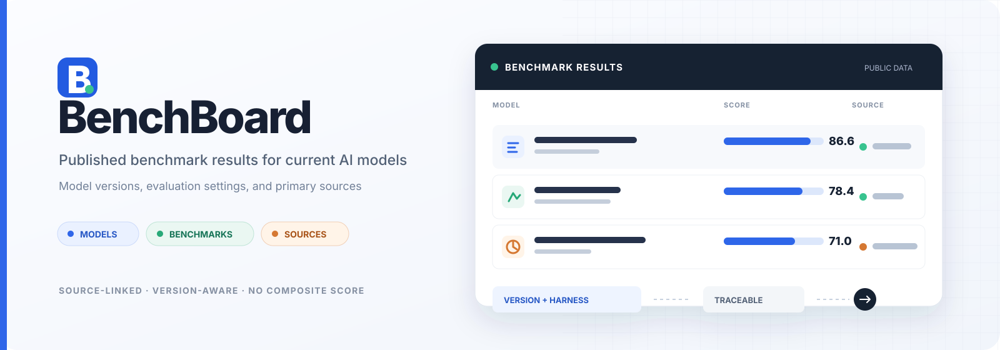
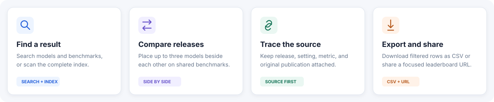
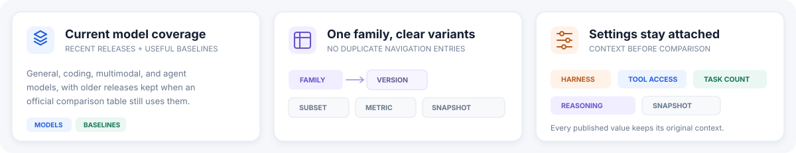

<div align="center">
  <a href="https://syuan03.github.io/benchboard/"></a>

  <p>
    <a href="https://syuan03.github.io/benchboard/"></a>
  </p>

  <p><a href="https://syuan03.github.io/benchboard/">Leaderboard</a> · <a href="docs/audits/model-source-coverage.md">Source coverage</a> · <a href="CONTRIBUTING.md">Contribute</a></p>
</div>

BenchBoard indexes published benchmark results for current AI models. Every score keeps its model release, benchmark variant, evaluation setting, and original source attached. Results from different harnesses or versions remain separate, and the site does not invent a cross-benchmark composite score.

<!-- DATA_SUMMARY_START -->
<p align="center"></p>
<p align="center"><sub>126 curated releases + 53 comparison-only models · 1,314 separately ranked metric and version views</sub></p>
<!-- DATA_SUMMARY_END -->

<h2> News</h2>

<table>
  <tr>
    <td align="center" width="48"></td>
    <td width="132"><strong>2026-10-18</strong><br><sub>COMPUTER-USE BENCHMARK</sub></td>
    <td>Added 259 results from Qwen's <a href="https://recreation-bench.cc/#leaderboard">RecreationBench paper leaderboard</a>: ten model configurations across overall and five separate platform views, plus nine published cost estimates. Programmatic, visual, threshold-coverage, and cost measures remain separate from earlier Qwen release scores with unspecified protocol.</td>
  </tr>
  <tr>
    <td align="center" width="48"></td>
    <td width="132"><strong>2026-10-18</strong><br><sub>AUDIO-VIDEO BENCHMARK</sub></td>
    <td>Added the <a href="https://01yzzyu.github.io/OmniCapBench/#leaderboard">OmniCapBench official leaderboard</a>: 198 values for nine models across 13 structural and nine localized semantic measures on 786 videos. The two tracks, candidate labels, and published metric definitions remain distinct.</td>
  </tr>
  <tr>
    <td align="center" width="48"></td>
    <td width="132"><strong>2026-10-17</strong><br><sub>CONTEXT LEARNING BENCHMARKS</sub></td>
    <td>Added 296 previously missed results from the official <a href="https://www.clbench.com/#section-clb">CL-bench</a> and <a href="https://www.clbench.com/#section-life">CL-bench Life</a> leaderboards: 36 and 29 model-mode rows across five professional-context and four real-life-context views. Candidate modes, single runs, published standard deviations, and the two benchmarks' task sets and judge settings remain separate.</td>
  </tr>
  <tr>
    <td align="center" width="48"></td>
    <td width="132"><strong>2026-10-16</strong><br><sub>VISUAL AGENT BENCHMARK</sub></td>
    <td>Added the <a href="https://blenderworld.github.io/#leaderboard">BlenderWorld official leaderboard</a>: 195 results for 13 models across the six main-table metrics and nine 3D-creation categories. Text-only and image/video-reference tasks, rubric scores, visual-quality scores, and fully satisfied rubrics remain separate; category means retain the precision in the maintainer's site data.</td>
  </tr>
  <tr>
    <td align="center" width="48"></td>
    <td width="132"><strong>2026-10-16</strong><br><sub>AGENT BENCHMARK AUDIT</sub></td>
    <td>Added 147 previously missed results from <a href="https://github.com/QwenLM/E-CommerceBench/blob/2c2fdedd382c0f2d507b6338ab80a5f7e0ddeb4c/README.md">E-Commerce Bench's official 21-row table</a>: final assets and six separate negotiation, fraud, solvency, efficiency, return, and learning measures. The Preview model labels, high/max reasoning settings, and later evaluations remain distinct.</td>
  </tr>
  <tr>
    <td align="center" width="48"></td>
    <td width="132"><strong>2026-10-15</strong><br><sub>MODEL SOURCE AUDIT</sub></td>
    <td>Added the previously missed <a href="https://openai.com/index/introducing-gpt-6-1-sol/">GPT-6.1 Sol first-party release charts</a>: 102 exact chart points across six benchmark views, with model versions, reasoning efforts, and per-task costs attached. The <a href="https://deploymentsafety.openai.com/gpt-6-1-sol">September 29 system card addendum</a> supplies 12 separately labeled HealthBench and MentalHealthBench results for GPT-6.1 Sol.</td>
  </tr>
  <tr>
    <td align="center" width="48"></td>
    <td width="132"><strong>2026-10-15</strong><br><sub>LEADERBOARD AUDIT</sub></td>
    <td>Updated the <a href="https://pinchbench.com/">PinchBench v2 maintainer leaderboard</a> with Best and Average scores for two newly listed NVIDIA Nemotron 3.5 Bolt variants. All 59 previously stored model rows still match the live board; its 147-task display remains at odds with the v2.0.0 release note's 148.</td>
  </tr>
  <tr>
    <td align="center" width="48"></td>
    <td width="132"><strong>2026-10-14</strong><br><sub>BENCHMARK AUDIT</sub></td>
    <td>Added the <a href="https://github.com/MoonshotAI/PerceptionBench">PerceptionBench official leaderboard</a>: 176 results for 16 models across overall accuracy and ten distinct visual perception categories. All values match the authors' <a href="https://arxiv.org/abs/2607.24957">technical report</a>; reasoning settings and Claude Fable 5's fallback protocol remain attached to the scores.</td>
  </tr>
  <tr>
    <td align="center" width="48"></td>
    <td width="132"><strong>2026-10-13</strong><br><sub>BENCHMARK AUDIT</sub></td>
    <td>Added the <a href="https://explorationbench.com/#leaderboard">ExplorationBench official leaderboard</a>: 220 separately labeled results for ten systems across AlienCode and AlienLogic. Baseline, Best@3, Mean@3, Worst@3, complete-rule references, auxiliary measures, and matched controls remain distinct. The <a href="https://github.com/Tencent-Hunyuan/ExplorationBench">official repository</a> also prints the 60 shared headline values.</td>
  </tr>
  <tr>
    <td align="center" width="48"></td>
    <td width="132"><strong>2026-10-12</strong><br><sub>VOICE BENCHMARK AUDIT</sub></td>
    <td>Added the exact values from OpenAI's <a href="https://openai.com/index/introducing-gpt-live-1-in-the-api/">GPT-Live-1</a> and <a href="https://openai.com/index/advancing-voice-intelligence-with-new-models-in-the-api/">GPT-Realtime-2</a> release charts: 25 results across nine voice benchmark views. Tau3 voice backends, Full Duplex Bench versions, reasoning settings, and turn-taking latency remain distinct.</td>
  </tr>
  <tr>
    <td align="center" width="48"></td>
    <td width="132"><strong>2026-10-11</strong><br><sub>LEADERBOARD AUDIT</sub></td>
    <td>Completed the 35-row <a href="https://www.tbench.ai/">Terminal-Bench 4.0 official leaderboard</a>, including separate effort settings for GPT-6 Astra, Claude Fable 5.1, and Claude Opus 5. Maintainer-run scores retain their harness and run details. Flagged the <a href="https://pinchbench.com/">PinchBench v2</a> task-count conflict: 147 on the live board versus 148 in its release notes.</td>
  </tr>
  <tr>
    <td align="center" width="48"></td>
    <td width="132"><strong>2026-10-10</strong><br><sub>MODEL RELEASES</sub></td>
    <td>Added Claude Sonnet 5.5, Claude Haiku 5.5, Gemini 4 Argon, and Mistral Large 4 Preview. Imported the exact capability results reported by their official release pages and system cards.</td>
  </tr>
  <tr>
    <td align="center"></td>
    <td><strong>2026-09-28</strong><br><sub>MODEL RELEASES</sub></td>
    <td>Added Claude Opus 5.5, Grok 4.7, GPT-6 Sol, and GPT-6 Luna, plus the full MentalHealthBench views and complete CursorBench 4.0 table.</td>
  </tr>
  <tr>
    <td align="center"></td>
    <td><strong>2026-09-21</strong><br><sub>SOURCE AUDIT</sub></td>
    <td>Completed a broad first-party sweep across release pages, model cards, repositories, and technical reports. Added a generated <a href="docs/audits/model-source-coverage.md">source coverage matrix</a>.</td>
  </tr>
  <tr>
    <td align="center"></td>
    <td><strong>2026-09-20</strong><br><sub>COLLECTION</sub></td>
    <td>Added the <a href="https://syuan03.github.io/benchboard/?collection=multimodal-harness">Multimodal Input × Harness collection</a> for tasks that give an agent images, audio, video, screens, or other non-text files.</td>
  </tr>
  <tr>
    <td align="center"></td>
    <td><strong>2026-09-18</strong><br><sub>PROJECT LAUNCH</sub></td>
    <td>Published the first BenchBoard dataset with representative GPT, Claude, Gemini, DeepSeek, Qwen, GLM, Seed, Kimi, and Hy releases.</td>
  </tr>
</table>

<h2> Use the data</h2>

<p align="center"><a href="https://syuan03.github.io/benchboard/"></a></p>

Search or scan the complete benchmark index, compare up to three releases, and export the current view as CSV. Opening a model shows every recorded result and setting for that release. The coverage matrix records how completely each source has been checked, and conflicting published values remain visible.

<h2> Coverage</h2>

<p align="center"></p>

The index focuses on recent general, coding, multimodal, and agent models. Older models remain when an official result table uses them as comparisons. Current coverage includes GPT-6, Claude 5.5, Gemini 3.8, DeepSeek V4.1, Qwen3.8, GLM-5.3, Seed2.1, Kimi K3, Hy4, Grok 4.7, and many related releases.

Benchmark families appear once in navigation. Versions, subsets, and metrics are selectable inside that entry. Settings such as reasoning effort, harness, tool access, task count, and snapshot date remain attached to each result.

<details>
<summary> <strong>Source and comparison policy</strong></summary>

Model providers, benchmark maintainers, model cards, technical reports, and official repositories are preferred. A provider can report results for competing models; those rows retain the reporting source. Conflicting first-party values stay separate until the settings or data can be reconciled.

A source audit records whether a page was checked in full, checked for selected model columns, used only for metadata, partially imported, inaccessible, or still pending. The generated [model source coverage matrix](docs/audits/model-source-coverage.md) makes that status visible.

BenchBoard is an evidence index. It does not claim independent reproduction or recommend one model from a single score.
</details>

<details>
<summary> <strong>Multimodal Input × Harness criteria</strong></summary>

This collection requires both a named agent harness, such as OpenClaw, Claude Code, Codex, OpenCode, or OpenHands, and a task that supplies non-text input. Advertising a model as multimodal is not enough. Text-only generation judged by a vision model is also excluded.

Mixed suites are labeled separately from dedicated multimodal subsets. The input modalities and harness remain visible in the benchmark entry.
</details>

<h2> Contribute</h2>

Missing result or incorrect setting? Read [CONTRIBUTING.md](CONTRIBUTING.md), then open an issue or pull request with the original source.

BenchBoard is a static site. To run it locally:

```bash
python3 -m http.server 8000
```

After editing the registry or a data pack:

```bash
npm run check
npm run sync-readme
npm run sync-source-matrix
npm run audit
```

Pushes to `main` are checked and deployed to GitHub Pages. The code and data organization are available under the [MIT License](LICENSE).
